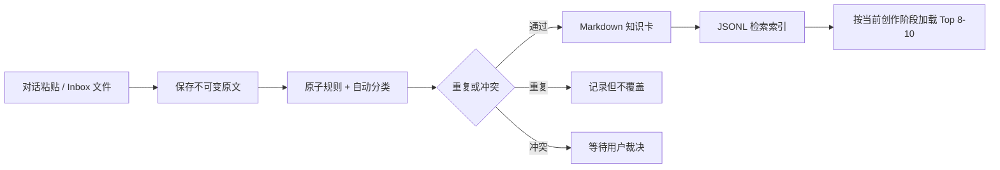

# mm-write-short-drama v1.1（短剧编剧 Codex Skill）

一个面向长流程短剧创作的 Codex Skill。它支持原创与小说/故事改编，通过故事圣经、整季结构、分集矩阵、场次卡、连续性账本和证据化审核，生成上下文连贯、人物稳定、可表演、可制作的短剧剧本。v1.1 新增与 Skill 分离管理的个人编剧知识库。

它不会一次性盲写整季，也不负责分镜、图片/视频提示词、剪辑或发布。首版交付边界是“可进入制片或分镜环节的定稿剧本”。

## 功能

- 从一句创意、人物、冲突或结局建立原创项目；
- 将小说、故事、梗概或真实事件拆解并改编为短剧；
- 产出项目启动单、故事圣经、整季结构、分集矩阵、场次卡和标准剧本；
- 使用人物、知识、时间线、道具和伏笔账本维护跨集连续性；
- 分批写 3—5 集并按结构、人物、连续性、台词、制作等维度返修；
- 对对白做基于动机、潜台词和人物声纹的“去 AI 味”处理；
- 接收新的编剧技巧，保留来源、拆分原子规则、检测冲突并按适用范围调用；
- 支持对话粘贴或批量 Inbox 录入，使用 Markdown 知识卡和 JSONL 索引持续积累个人知识；
- 在策划、结构、分集、场景、对白、改编和审核阶段只检索相关 active 规则，并记录实际使用的规则 ID；
- 评估真人拍摄、AI 真人剧、AI 漫剧或混合制作风险。

完整架构、状态机、流程图和原创/改编示例见 [v1.1 个人编剧知识库系统设计](docs/knowledge-base-design-v1.1.md)。

## 版本与升级记录

当前稳定版本是 `v1.1.0`。仓库同时保留每个正式版本的功能介绍、安装方式、使用命令和能力边界：

- [全部升级记录](CHANGELOG.md)
- [v1.1 功能与使用说明](docs/versions/v1.1.md)
- [v1.0 功能与使用说明](docs/versions/v1.0.md)

Git 标签用于复现对应版本；升级到新版时只替换 Skill 本体，不覆盖个人 `knowledge-base/` 或已有短剧项目。

## 安装

### 方法一：克隆到 Codex Skills 目录（推荐）

```bash
mkdir -p ~/.codex/skills
git clone https://github.com/CodeBlueFriend/mm-write-short-drama.git /tmp/mm-write-short-drama-repo
cp -R /tmp/mm-write-short-drama-repo/mm-write-short-drama ~/.codex/skills/mm-write-short-drama
```

重新打开 Codex 或启动一个新任务，让 Skill 列表刷新。看到“短剧编剧”即安装成功。

如果已有旧版本，先备份其中自行增加的技巧，再用新版 `mm-write-short-drama/` 目录替换。不要直接覆盖仍在使用的短剧项目目录；项目数据和 Skill 本体应分开保存。

`knowledge-base/` 不复制进 Skill 安装目录。把它保留在长期工作区，并在项目启动单填写绝对路径或仓库相对路径。以后升级 `mm-write-short-drama/` 时不会覆盖个人知识。

### 方法二：从本地仓库安装

```bash
cp -R ./mm-write-short-drama ~/.codex/skills/mm-write-short-drama
```

## 最快上手

在 Codex 中显式调用：

```text
$mm-write-short-drama 根据这个创意建立 6 集竖屏都市情感短剧项目：
一个替人分手的职业谈判师，接到的客户竟是自己的未婚夫。
采用严格确认模式，先完成项目启动单和故事圣经，不要直接写剧本。
```

也可以自然触发：

```text
把我提供的小说前五章改编成 6 集真人短剧。先建立原著索引和事实库，给我改编映射，确认后再做分集。
```

第一次合作推荐“严格确认模式”：在故事圣经、整季结构、首批分集和每批剧本后确认。流程成熟后可切换为辅助确认；自动推进遇到 BLOCKER、规则冲突、重大改编或锁定事实变化仍会停下。

## 常见用法

### 1. 原创短剧

```text
$mm-write-short-drama 原创一部 12 集女频悬疑短剧，单集 90 秒，竖屏、低成本真人拍摄。
核心人物是一位替老人整理遗物的年轻遗物整理师，结局偏温暖但不能轻飘。
先给项目启动单；缺失的关键问题一次最多问三个。
```

### 2. 小说改编

把有权使用的 `.md` 或 `.txt` 原文放在工作区，然后说：

```text
$mm-write-short-drama 把 ./source/novel.md 改编为 24 集短剧。
先索引原文，区分原著事实、合理推断、改编决定和待确认项。
本轮只交付原著事实库、改编映射和故事圣经。
```

Skill 会记录用户声明的授权状态，但不会替代版权与法律判断。

### 3. 分批写剧本

```text
$mm-write-short-drama 读取 ./projects/逆光 项目状态，写 EP006—EP010。
先生成该批最小上下文包，核对人物信息状态和未回收伏笔；写完后更新账本并出审核报告。
```

### 4. 连续性审核

```text
$mm-write-short-drama 审核 EP001—EP010 的人物伤势、秘密获知时间、手机和钥匙去向、日夜时间线及伏笔回收。
每个问题给出集/场位置、账本证据、等级、影响范围和最小修法；先不要自动改写。
```

### 5. 去 AI 味

```text
$mm-write-short-drama 保持 EP003 的事实、人物动机和场景结果不变，诊断并改写对白的 AI 味。
先列出人物同声同气、解释性对白、情绪直译和模板句式，再给局部修订及事实复核。
```

### 6. 加入编剧技巧

```text
$mm-write-short-drama 把这条技巧加入规则库，只适用于女频复仇的分集设计：
主角第一次有效反击必须改变资源、关系或信息状态，不能只获得口头胜利。
保留原文和来源，拆成原子规则，检查与现有规则冲突；有冲突先让我裁决。
```

## v1.1 个人编剧知识库



目录位于仓库根目录：

```text
knowledge-base/
├── inbox/       # 待处理资料，处理后仍保留
├── sources/     # 不可变原文与 SHA-256
├── cards/       # 一条规则一张 Markdown 卡
├── index/       # 可重建 JSONL 索引
├── conflicts/   # 重复、冲突和裁决日志
└── archive/     # 状态或版本变化前的快照
```

### 日常录入一条技巧

用户已经确认、准备直接启用时：

```bash
python3 mm-write-short-drama/scripts/ingest_knowledge.py \
  --kb ./knowledge-base \
  --text "主角第一次有效反击必须改变资源、关系或信息状态，不能只获得口头胜利。" \
  --rule "主角第一次有效反击必须改变资源、关系或信息状态，不能只获得口头胜利。" \
  --source-name codex-conversation.md \
  --title "首次有效反击" \
  --rationale "可观察的状态变化才能让反击进入后续因果。" \
  --category "分集与卡点" \
  --stage episode \
  --genre "女频复仇" \
  --production-mode all \
  --priority preferred \
  --exceptions "经确认的前期压抑型结构" \
  --positive-example "女主公开账本后夺回项目表决权。" \
  --negative-example "女主只把反派骂走，局势没有变化。" \
  --status active
```

当用户粘贴的原文还包含适用范围、课程解释等内容时，`--text` 保留完整原文，`--rule` 只放提炼后的单条原子规则；二者不要互相替代。

需要先人工复核时省略覆盖字段，并保持默认 `draft`：

```bash
python3 mm-write-short-drama/scripts/ingest_knowledge.py \
  --kb ./knowledge-base \
  --text "这里粘贴课程、文章或自己的编剧总结" \
  --source-name lesson-12.md
```

### 批量录入多期资料

先把 `.md` / `.txt` 放入 `knowledge-base/inbox/`，再运行：

```bash
python3 mm-write-short-drama/scripts/ingest_knowledge.py \
  --kb ./knowledge-base \
  --all-inbox
```

脚本不会移动、改名或删除 Inbox 原文件。原文副本进入 `sources/`，重复规则只记日志，疑似冲突变为 `pending-conflict`。

### 检索当前阶段知识

```bash
python3 mm-write-short-drama/scripts/search_knowledge.py \
  "女主第一次反击和本集结尾卡点" \
  --kb ./knowledge-base \
  --stage episode \
  --genre "女频复仇" \
  --production-mode live-action \
  --limit 8 \
  --format context
```

默认只返回 `active`。当前项目明确要求和锁定事实始终优先；`pending-conflict` 不会被调用。

### 校验知识库

```bash
python3 mm-write-short-drama/scripts/validate_knowledge.py \
  --kb ./knowledge-base \
  --fix-index
```

### 裁决冲突

```bash
python3 mm-write-short-drama/scripts/ingest_knowledge.py \
  --kb ./knowledge-base \
  --resolve KBC-XXXXXXXXXXXX \
  --decision keep-existing
```

也可选择 `activate-new`；若选择 `keep-both`，必须用 `--note` 写清两条规则已经分离的适用范围。

## 小说上传改编示例

把有权使用的小说 `.md`/`.txt` 上传到 Codex 或放进工作区，然后使用：

```text
$mm-write-short-drama 把我上传的 novel.md 改编成24集竖屏真人短剧，单集90秒。
个人知识库使用 ./knowledge-base。
先索引全文，区分原著事实、合理推断、改编决定和待确认项；
只检索 adaptation、都市情感、live-action 相关的 active 知识卡。
本轮只交付原著事实库、改编映射和故事圣经，不写分集和剧本。
审核摘要列出实际使用的知识规则 ID。
```

小说正文属于短剧项目素材，不要放入 `knowledge-base/`；知识库只保存可复用的编剧方法和指导。

## 根据思路原创短剧示例

```text
$mm-write-short-drama 根据这个思路原创6集竖屏都市悬疑短剧：
一位便利店夜班店员替陌生人保管秘密，最后发现秘密都指向同一场旧案。
低成本真人拍摄，单集90秒，结局温暖但不能靠巧合。
使用 ./knowledge-base，只检索 planning 阶段、都市悬疑、live-action 相关的 active 规则。
严格确认模式，先完成项目启动单、原创故事发现和故事圣经；不要直接写分集。
说明实际使用了哪些知识规则 ID。
```

进入整季结构、分集、场景和对白阶段时分别重新检索对应阶段，避免把全库塞进上下文。

## 项目文件如何工作

聊天不是最终事实源。每个项目都把已确认内容保存为文件：

```text
project-name/
├── 00-project-brief.md
├── 01-source-index.md          # 改编项目
├── 02-source-truth.md          # 改编项目
├── 03-adaptation-map.md        # 改编项目
├── 03-original-discovery.md    # 原创项目；与改编映射二选一
├── 04-story-bible.md
├── 05-season-architecture.md
├── 06-episode-matrix.csv
├── continuity/
│   ├── canon.yaml
│   ├── timeline.csv
│   ├── character-state.csv
│   ├── knowledge-state.csv
│   ├── props-ledger.csv
│   └── hooks-ledger.csv
├── episodes/
├── reviews/
├── context-packs/
├── locked-decisions.md
└── change-log.md
```

事实分为五层：L0 用户锁定；L1 已审核；L2 当前计划；L3 临时候选；L4 已废弃。只有 L0/L1 能被后续当作既定事实。修改锁定事件前，Skill 应先报告受影响集数、人物动机、时间线、伏笔、道具和信息状态。

## 命令行工具

这些脚本只负责可重复的索引、装配、字段校验和统计；创作质量仍由工作流审核。

```bash
SKILL_DIR=./mm-write-short-drama
```

### 初始化项目

```bash
python3 "$SKILL_DIR/scripts/init_project.py" ./projects/my-drama --mode original
python3 "$SKILL_DIR/scripts/init_project.py" ./projects/my-adaptation --mode adaptation
python3 "$SKILL_DIR/scripts/init_project.py" ./projects/my-gate-a --mode original --through story-bible
```

`--through brief` 只创建启动阶段文件；`--through story-bible` 创建到审核门 A；默认 `full` 创建完整骨架。为保护已有项目，目标目录非空时脚本会拒绝覆盖。

### 给原著建立稳定索引

```bash
python3 "$SKILL_DIR/scripts/index_source.py" ./source/novel.md \
  -o ./projects/my-adaptation/01-source-index.md
```

支持一个或多个 `.md` / `.txt` 文件或目录。章节索引包含稳定 Source ID、行号、字符数和内容摘要哈希，便于改编事实引用证据位置。

### 构建一批剧本的最小上下文包

```bash
python3 "$SKILL_DIR/scripts/build_context_pack.py" ./projects/my-drama \
  --episodes 6-10
```

默认输出到 `context-packs/EP006-EP010-context.md`。上下文包是源文件快照，不会成为新的事实源；正式写作前仍需核对关键账本。

### 校验项目结构

```bash
python3 "$SKILL_DIR/scripts/validate_project.py" ./projects/my-drama --mode original
python3 "$SKILL_DIR/scripts/validate_project.py" ./projects/my-adaptation --mode adaptation --json
python3 "$SKILL_DIR/scripts/validate_project.py" ./projects/my-gate-a --mode original --stage gate-a
```

脚本检查必需文件、CSV 字段、剧本标题/控制信息/连续性更新、标准场景头和分集矩阵映射。错误返回非零退出码，警告不会阻断。

### 统计剧本

```bash
python3 "$SKILL_DIR/scripts/screenplay_stats.py" ./projects/my-drama/episodes
python3 "$SKILL_DIR/scripts/screenplay_stats.py" ./projects/my-drama/episodes --json
```

统计场次、对白行/字数、动作字数、说话角色和粗略时长。时长只是异常检测信号，不替代朗读、表演节奏和剪辑判断。

所有脚本的完整参数均可用 `--help` 查看。

### 个人知识库脚本

- `ingest_knowledge.py`：保留原文、提炼候选原子规则、分类、查重、冲突冻结、用户裁决和重建索引；
- `search_knowledge.py`：按任务、阶段、题材、制作模式和状态检索；
- `validate_knowledge.py`：检查卡片字段、来源哈希、冲突状态和索引；
- `knowledge_lib.py`：三套命令共享的标准库实现。

## 审核标准

审核固定从上游到下游：结构因果 → 原著忠实（改编）→ 人物动机/信息 → 连续性 → 节奏 → 去 AI 味 → 制作 → 格式。每个问题必须带位置、证据、等级、影响和修法。

交付硬条件：BLOCKER 为 0；锁定事实冲突为 0；角色提前获知为 0；关键道具和时间线断裂为 0；重大改编全部记录；每场都有戏剧功能；建议总分不低于 85/100。

## 仓库结构

```text
mm-write-short-drama/       # 可直接安装的 Skill
├── SKILL.md                # 路由、主流程、审核门和资源读取规则
├── agents/openai.yaml      # Codex UI 元数据
├── references/             # 按阶段加载的创作与审核规则
├── assets/                 # 项目、故事圣经、分集、场次、剧本、审核模板
└── scripts/                # 确定性辅助工具
knowledge-base/             # 与 Skill 分离的个人长期知识
docs/                       # 设计映射和测试提示集
```

## 故障排查

- **Codex 没显示 Skill**：确认目录是 `~/.codex/skills/mm-write-short-drama/SKILL.md`，不是多嵌套了一层仓库名；重新启动 Codex 或新建任务。
- **Skill 直接开始写全剧**：显式要求“严格确认模式，先过故事圣经审核门 A”，并确认项目文件可写。
- **续写时忘记旧事实**：要求先运行上下文包脚本，并明确读取相关连续性账本和最新 `change-log.md`。
- **校验提示缺文件**：先用 `init_project.py` 创建完整项目骨架；旧项目可按 `assets/` 模板补齐，但不要覆盖已有内容。
- **中文文件乱码**：脚本按 UTF-8/UTF-8 with BOM 读取；先把源文件转换为 UTF-8。
- **时长估计不准**：用 `--chars-per-second` 调整对白语速，最终以真人朗读为准。
- **知识卡没有被检索**：确认状态为 `active`，阶段/题材/制作范围匹配，并在项目启动单写对知识库路径。
- **出现冲突规则**：查看 `knowledge-base/conflicts/open.jsonl`，未裁决前不要把卡片手工改为 active。

## 开发与验证

```bash
python3 /path/to/skill-creator/scripts/quick_validate.py ./mm-write-short-drama
python3 -m py_compile ./mm-write-short-drama/scripts/*.py
python3 -m unittest discover -s tests -v
python3 ./mm-write-short-drama/scripts/validate_knowledge.py --kb ./knowledge-base --fix-index
```

建议用 [测试提示集](docs/test-prompts.md) 做触发、原创、改编、连续性陷阱、去 AI 味和技巧冲突回归测试。

## 设计来源与许可

v1.0 实现依据用户提供的《短剧编剧 Skill 完整项目设计 v1.0》；v1.1 增加与 Skill 分离的个人编剧知识库，并继续遵守渐进加载原则。代码与文档采用 MIT License；用于改编的第三方素材仍受其自身权利约束。
