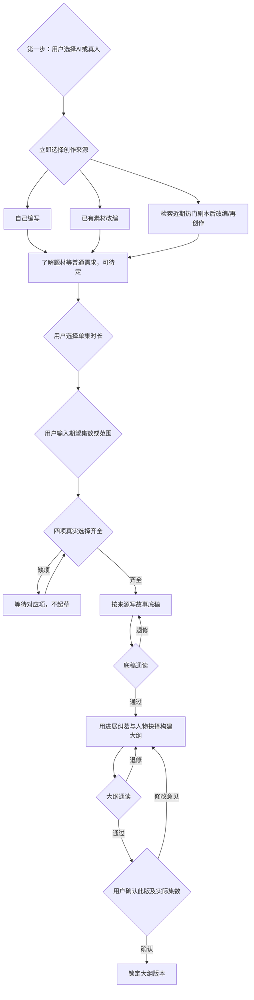
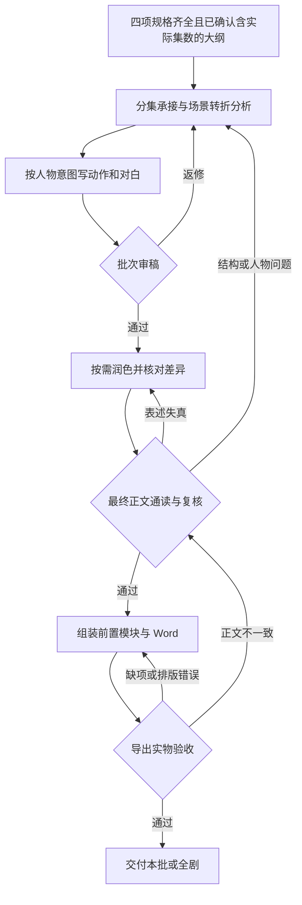
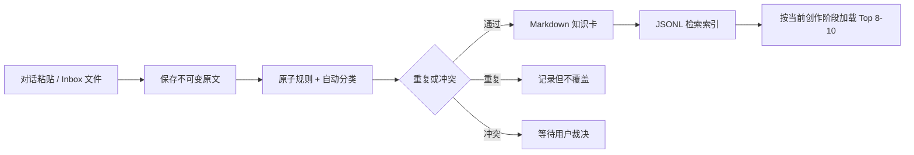

# 短剧编剧 · mm-write-short-drama

可以先试写一场，或只改手里的几句对白。正式新项目第一步由用户选择AI或真人，选完立即选择创作来源，再了解题材等需求、选择单集时长和期望集数，随后把故事讲到结局，审过底稿和大纲，等创作者明确确认这一版，再分批写成可表演的短剧。每批交付一个含完整项目介绍的 Word；正文审读、事实复核和导出实物验收都对应实际文件版本。

当前正式版为 [v1.3.0](https://github.com/CodeBlueFriend/mm-write-short-drama/releases/tag/v1.3.0)。保留个人知识库、故事圣经、分集矩阵、场次卡与连续性账本，新增试戏与独立主笔、三来源入口、大纲确认、两遍审读、五书24项方法摘要及正式交付门。它负责剧本，不负责分镜、生图、视频生成、剪辑或发布。

[安装技能](#安装与升级) · [先试一场](#先试一场) · [五书方法与来源](#五书方法与来源) · [命令行手册](docs/usage.md) · [v1.3 升级说明](docs/versions/v1.3.md) · [交流与反馈](#交流与反馈)

## 先试一场

想先听角色开口，可以说“只试写一场，给我看这对母女怎么要回一把钥匙”。直接返回候选场次；只改已有段落时，沿用原稿格式和允许改动的范围。涉及已有项目，只补读相关锁定事实与上场结尾。此入口不要求先初始化项目、全套知识检索、迁移状态、执行正式交付润色或导出 Word。试稿经你采纳后，再按项目审核和版本流程并入正式稿；只要求审核时，先给原文依据和诊断，等你要求改写再改。

默认由本轮模型主笔。想分开主流程与写作模型，可以说“这场请委派 drama_writer，主会话整理事实、审稿，原样交付获选主笔稿”。交接只带场景任务、锁定事实、上场最后动作、各人知道什么、允许发明的空间及交稿格式；需要局改时附原段、相关上下文与必须保留的句子。返修送回同一主笔，主会话负责存档、编号和交付。

项目级配置示例见 [.codex/agents/drama-writer.toml](.codex/agents/drama-writer.toml)，示例主笔为 `gpt-6.2-astra`、推理强度为 `medium`。只安装 Skill 到另一个写作项目时，需把配置放入实际项目的相同位置；主会话仍使用输入框选定的模型。以实际启动的子任务及返回结果为准，委派失败时如实报告。具体写法与选版方法见 [主笔写戏](mm-write-short-drama/references/lead-writer.md)。

<a id="从创意到交付"></a>

## 从哪里开始

正式新项目先按“AI或真人 → 创作来源 → 题材等需求 → 单集时长 → 期望集数”取得真实选择；用户已经说清的项直接记录，不重复问；制作方式未选时首问必须是AI或真人，不能先问来源或题材。题材等普通需求可先标待定。集数可为具体数或范围，允许按完整故事合理浮动；未齐时只建空骨架/启动单并保存原始素材，不默认真人6集，也不构思底稿或大纲。四项规格（制作方式、来源、时长、期望集数）齐全后三种来源共用“故事底稿→底稿审读→大纲→大纲审读→用户确认”；已说明来源直接选中。

本次固定策略：真人推荐90秒，常见60—180秒、爆款常规80—120秒，新项目硬上限180秒；旧有更长存量不作新项目默认。AI主流50—60秒、90秒可选，超过120秒少见；用户明确自定义可以保留并标非常规。这是用户指定的项目策略，不是新查到的平台规定。

| 来源 | 普通指令示例 | 在开始写正文前交付 |
|---|---|---|
| 自己编写（自主创意） | `做AI短剧，选择自己编写；每集50—60秒，期望40—60集。创意：替人道歉的代理人，被迫替失踪十年的父亲向全城人道歉。` | 保留原始创意与锁定项，补足人物当下必须做的事、失败、取舍和结果，审后给大纲。 |
| 已有素材改编（含小说） | `做真人短剧，选择已有素材改编；题材为都市情感，每集90秒，期望6集，改编我提供的小说前五章，先给大纲。` | 原著版本、章节定位、可用范围和授权状态，改编取舍与从开头讲到结局的故事底稿；未提供后续注明拟改编。 |
| 检索近期热门剧本后改编/再创作 | `做真人短剧，选择检索近期热门剧本后改编/再创作；题材家庭关系，每集90秒，期望60集，先查可见材料。` | 检索日期、窗口、平台地区、榜期与指标、链接和实际读到的内容层级，来源类型、授权状态、差异表与改编/再创作方案。只有宣发就按宣发分析，热度不能核实就标待核。 |



呈给创作者的大纲包括一句话故事、连读梗概、主要人物目标与变化、分阶段因果、高潮结局、核心伏笔及兑现位置，同时写明用户期望集数、实际规划总数、所选单集时长和本次范围。实际数可合理浮动，偏离具体数或范围须写剧情理由，不设固定±10%；最终随大纲人工确认。严格、辅助、自动三种工作模式都必须停在这一版大纲的人工确认点。用户只要大纲时，在此结束。

“继续”“看看”“自动推进”不替代确认。记录用户确认原话、对话定位、时间、范围和当前内容hash；上游变动后旧确认失效，重启仍从等待点恢复。

## 确认之后怎么写



默认每批3—5集。先生成场次和行动，再写对白；每集用真实正文回填人物决定、另一条可走的路、可见结果和下一集承接。保留能改变关系的静场。返修涉及已确认的主角目标、核心冲突、重大转折或结局时，回到图一重审并重新确认。

方法必须影响具体稿件。实际合成示范《旧伞借还》中，大纲把“赶已付费拼车”与“承担车费及新伞损失，留下共同修伞”写成可执行的选择；场次落实为关提醒、取消等待、拆红伞；对白从“看不出来就行”变为“剪开这儿，补多大一块？”。[查看结构、场次与对白的实际交付片段](docs/examples/旧伞借还-method-trace.md)。示范使用软件模拟确认，实际产物不替代匿名比较的效果结论。

审核先只读最终正文，记录此刻理解的人物目标、担忧、被迫改变策略的事件及首次卡点，再揭示大纲、来源和事实账本核对。首读不懂的地方不能在看完作者解释后倒填成原先已懂。超过上下文时按连续场次分块，记录实读覆盖与版本，再回读跨块因果；漏读一集或中断都保持“审核未完成”。

若EP003的角色用了EP005才公开的信息，先记录两处原文、退回相关场次修订，重读提前知情的前因与后果，再用新hash审稿。手填 `--blocking-issues 0` 不能消除这条阻断。修后只重新检查受影响范围，最终交付仍通读实际输出版本。同一问题最多两轮自动返修，仍有分歧则保留待修稿请用户裁决。

<a id="四本书对应的五项写作能力"></a>

## 五书方法与来源

随包方法摘要固定来自 [五书仓库6e99009的统一导入目录](https://github.com/CodeBlueFriend/short-drama-book-skills/tree/6e99009572a64f99d60134405fbf1cf200b0dfe4/knowledge-inbox)。它们不是原书全文，不能据此声称全文逐字校勘。用户不用先报书名；按当前决定选方法，个人已核卡优先，内置摘要兜底。

| 书或材料 | 本次启用范围与来源边界 |
|---|---|
| 《救猫咪》 | 一句话梗概、整季节拍两项；公开原则与短剧适配分开标识。[梗概材料](https://github.com/CodeBlueFriend/short-drama-book-skills/blob/6e99009572a64f99d60134405fbf1cf200b0dfe4/knowledge-inbox/first-four-03-save-the-cat-logline.md)、[结构材料](https://github.com/CodeBlueFriend/short-drama-book-skills/blob/6e99009572a64f99d60134405fbf1cf200b0dfe4/knowledge-inbox/first-four-04-save-the-cat-beat-sheet.md)。 |
| 《对白》 | 言语行动，用于场次和对白的要求、回应与换策略。[方法材料](https://github.com/CodeBlueFriend/short-drama-book-skills/blob/6e99009572a64f99d60134405fbf1cf200b0dfe4/knowledge-inbox/first-four-05-mckee-verbal-action.md)。 |
| 《编剧路线图》 | 人物秘密/知情边界；书籍来源不足处标项目方法，不能把目录主题当全文核验。[交接材料](https://github.com/CodeBlueFriend/short-drama-book-skills/blob/6e99009572a64f99d60134405fbf1cf200b0dfe4/knowledge-inbox/first-four-02-showrunner-character-mystery.md)。 |
| 《从零开始学短剧创作》 | 相邻集承诺和兑现；标明公开目录范围及交接包项目实务。[交接材料](https://github.com/CodeBlueFriend/short-drama-book-skills/blob/6e99009572a64f99d60134405fbf1cf200b0dfe4/knowledge-inbox/first-four-01-short-drama-payoff-turn.md)。 |
| 麦基《故事》 | 19个稳定能力ID，覆盖激励事件、进展纠葛、危机选择、场次分析、伏笔兑现、信息、动作和改编等；旧01—06为上游修订2，07—19为修订1。中文来源记为周铁东译、天津人民出版社2014年版，章节/电子定位与原书hash随卡保留，纸本页码和全文逐字校勘仍待核。[译本与交接说明](https://github.com/CodeBlueFriend/short-drama-book-skills/blob/6e99009572a64f99d60134405fbf1cf200b0dfe4/story-handoff/README.md)。 |

v1.2.2 的三张公开卡仍随包保留用于兼容；正常检索优先使用当前五书24项方法摘要，同能力的个人已启用卡优先于内置卡。

一个子任务通常选1张《故事》卡，明确跨域时最多2张；后续阶段可换卡。执行记录把“原问题→所选方法→上游决定→分集/场次/台词→复检结果”串起来，检索到不等于已使用。无秘密驱动的安静关系戏可以合理跳过秘密方法。完整能力索引见 [写作能力](mm-write-short-drama/references/writing-capabilities.md)。

<a id="安装"></a>

## 安装与升级

### 在 Codex 插件列表里安装

在终端添加插件来源，再安装「短剧编剧 · Screenwriter」：

```bash
codex plugin marketplace add CodeBlueFriend/mm-write-short-drama
codex plugin add mm-write-short-drama@short-drama
```

添加来源后，也可在 Codex CLI 输入 `/plugins`，切换到 `short-drama` 选择安装。装好后开启新对话。[Codex 插件来源说明](https://developers.openai.com/plugins/build/plugins#add-a-marketplace-from-the-cli) · [插件隐私说明](docs/plugin-privacy.md)

### 通过技能安装器安装正式版

在 Codex 粘贴以下指令，安装固定版本 [v1.3.0](https://github.com/CodeBlueFriend/mm-write-short-drama/releases/tag/v1.3.0)：

```text
$skill-installer 从 https://github.com/CodeBlueFriend/mm-write-short-drama/tree/v1.3.0/mm-write-short-drama 安装技能
```

五书方法摘要、状态与交付工具、可选 Humanizer 兼容规则和校验器随技能分发。打开存放素材和剧本的工作区，输入 `$mm-write-short-drama` 再说你想做什么。找不到技能时重新开启 Codex。[Codex 技能文档](https://developers.openai.com/codex/skills#install-curated-skills-for-local-use)

<details>
<summary>从 GitHub 手动安装</summary>

```bash
git clone --depth 1 --branch v1.3.0 \
  https://github.com/CodeBlueFriend/mm-write-short-drama.git
mkdir -p "$HOME/.agents/skills/mm-write-short-drama"
cp -R mm-write-short-drama/mm-write-short-drama/. "$HOME/.agents/skills/mm-write-short-drama/"
```

已有克隆时，从仓库根目录把 `./mm-write-short-drama/.` 复制到实际使用的技能目录。使用 `$CODEX_HOME/skills` 或 `~/.codex/skills` 的现有安装也可继续更新同一目录；不要同时维护多个会被发现的副本。

</details>

升级前先保留可恢复副本及哈希，只更新技能程序，不覆盖项目、个人知识库和历史交付。旧项目不会自动获得新版确认和批准；恢复时先映射真实状态与未决项。独立主笔配置不随单独安装 Skill 自动放进写作项目，需另外将 [.codex/agents/drama-writer.toml](.codex/agents/drama-writer.toml) 放入实际项目并加载。

运行需要 Python 3.10+；Word 导出需 `python-docx`，渲染验收另需可用文档渲染器、Pillow 及 PyMuPDF 或 pypdf。在 Codex 中优先使用工作区提供的 Python。缺包时可按 [依赖清单](mm-write-short-drama/scripts/requirements-word.txt) 准备项目环境。正式交付须通过实际渲染包装器和逐页检查，Word 或 LibreOffice 手工打开不能替代发布记录。

润色默认 `local` 按需局改，可选 `off` 原样复核；`full` 只在项目明确选择后使用。内置 `polish_guard.py` 记录逐差异和最终事实复核。随包 Humanizer 或外部适配器可作为项目唯一改写来源，不重复全量润色；其旧校验记录不能代替当前语义复核。[润色规则](mm-write-short-drama/references/humanizer-adapter.md) · [v1.3 升级说明](docs/versions/v1.3.md) · [完整变更记录](CHANGELOG.md)

## 常见请求

```text
$mm-write-short-drama 只试写一场：母亲想要回女儿攥着的旧房钥匙。女儿还不知道母亲已退租。用两个人、一张桌子，不先建项目。
```

```text
$mm-write-short-drama 这场请委派 drama_writer。只交接相关原文、锁定事实和人物知情边界；主会话审稿并原样交付获选主笔稿，修改意见送回同一主笔。
```

```text
$mm-write-short-drama 做真人短剧，选择自己编写；题材都市情感，每集90秒，期望60集。根据我的创意先讲通完整故事，审后给大纲，等我确认再写。
```

```text
$mm-write-short-drama 做AI短剧，选择已有素材改编；每集50—60秒，期望40—60集。改编novel.md前五章，标原著定位和改编决定，未提供后续写成候选方案。
```

```text
$mm-write-short-drama 做真人短剧，选择检索近期热门剧本后改编/再创作；题材家庭关系，每集90秒，期望60集。检索近30天可见材料，写清日期、平台、证据层级、热度待核项和改编取舍。
```

```text
$mm-write-short-drama 继续已有项目，先恢复当前等待点；若大纲已确认，写EP006—EP010并更新账本、批审和Word。
```

```text
$mm-write-short-drama 只审核这几场，不改稿。给出原文证据、影响、退回阶段和复检范围。
```

```text
$mm-write-short-drama 保留本场事实和声纹，先标表达问题，只改必要几句；无需改动的原样通过。
```

## v1.1 个人编剧知识库



目录位于仓库根目录：

```text
knowledge-base/
├── inbox/       # 待处理资料，处理后仍保留
├── sources/     # 不可变原文与 SHA-256
├── cards/       # 一条规则一张 Markdown 卡
├── index/       # 可重建 JSONL 索引
├── conflicts/   # 重复、冲突和裁决日志
└── archive/     # 状态或版本变化前的快照
```

### 日常录入一条技巧

用户已经确认、准备直接启用时：

```bash
python3 mm-write-short-drama/scripts/ingest_knowledge.py \
  --kb ./knowledge-base \
  --text "主角第一次有效反击必须改变资源、关系或信息状态，不能只获得口头胜利。" \
  --rule "主角第一次有效反击必须改变资源、关系或信息状态，不能只获得口头胜利。" \
  --source-name codex-conversation.md \
  --title "首次有效反击" \
  --rationale "可观察的状态变化才能让反击进入后续因果。" \
  --category "分集与卡点" \
  --stage episode \
  --genre "女频复仇" \
  --production-mode all \
  --priority preferred \
  --exceptions "经确认的前期压抑型结构" \
  --positive-example "女主公开账本后夺回项目表决权。" \
  --negative-example "女主只把反派骂走，局势没有变化。" \
  --status active
```

当用户粘贴的原文还包含适用范围、课程解释等内容时，`--text` 保留完整原文，`--rule` 只放提炼后的单条原子规则；二者不要互相替代。

需要先人工复核时省略覆盖字段，并保持默认 `draft`：

```bash
python3 mm-write-short-drama/scripts/ingest_knowledge.py \
  --kb ./knowledge-base \
  --text "这里粘贴课程、文章或自己的编剧总结" \
  --source-name lesson-12.md
```

### 批量录入多期资料

先把 `.md` / `.txt` 放入 `knowledge-base/inbox/`，再运行：

```bash
python3 mm-write-short-drama/scripts/ingest_knowledge.py \
  --kb ./knowledge-base \
  --all-inbox
```

脚本不会移动、改名或删除 Inbox 原文件。原文副本进入 `sources/`，重复规则只记日志，疑似冲突变为 `pending-conflict`。

### 检索当前阶段知识

```bash
python3 mm-write-short-drama/scripts/search_knowledge.py \
  "女主第一次反击和本集结尾卡点" \
  --kb ./knowledge-base \
  --stage episode \
  --genre "女频复仇" \
  --production-mode live-action \
  --limit 8 \
  --format context
```

默认只返回 `active`。当前项目明确要求和锁定事实始终优先；`pending-conflict` 不会被调用。

支持用 `--capability <原能力ID>` 精确补查；正常创作使用 `--format context`，让诊断、执行动作、输出、自检和例外进入落笔上下文。个人库同能力优先，无个人卡时使用随包已核方法摘要；来源不足、冲突及草稿卡不自动启用。范围见 [五书方法与来源](docs/current-design.md#五书方法与来源)。

### 校验知识库

```bash
python3 mm-write-short-drama/scripts/validate_knowledge.py \
  --kb ./knowledge-base \
  --fix-index
```

### 裁决冲突

```bash
python3 mm-write-short-drama/scripts/ingest_knowledge.py \
  --kb ./knowledge-base \
  --resolve KBC-XXXXXXXXXXXX \
  --decision keep-existing
```

也可选择 `activate-new`；若选择 `keep-both`，必须用 `--note` 写清两条规则已经分离的适用范围。

## 项目文件

```text
project-name/
├── .drama/
│   ├── project-state.json
│   ├── production-specs.json   # 用户期望规格及真实选择回执
│   ├── episode-plan.json       # 大纲实际总数和规划理由
│   ├── source-route-history/   # 切换来源前的原始证据归档
│   ├── artifact-index.json
│   ├── workflow.json
│   ├── invalidation-log.jsonl
│   ├── polish/
│   └── staging/
├── source-evidence.json       # 素材来源、可见证据和缺口
├── 03-story-treatment.md      # 从开端到结局的连续故事底稿
├── 00-project-brief.md
├── 01-source-index.md         # 改编/旧素材路径
├── 02-source-truth.md
├── 03-adaptation-map.md
├── 03-original-discovery.md
├── 04-story-bible.md
├── 05-season-architecture.md  # 供确认的完整大纲
├── 06-episode-matrix.csv
├── continuity/               # 人物、知情、时间、关系、钱物及伏笔
├── episodes/
├── front-matter.md            # 当前项目九模块
├── reviews/                  # 两遍实读记录、问题、覆盖及版本
├── deliverables/             # 每批一份验收后的正式Word
├── context-packs/
├── locked-decisions.md
└── change-log.md
```

事实仍分L0用户锁定、L1已审核、L2计划、L3假设、L4废弃，只有L0/L1作为既定事实。旧项目没有新版工作流记录时可只读诊断；不能自动把旧approved当新版已确认。整季续作先提出迁移映射和未决项。

## 命令行工作流

脚本负责证据、覆盖、版本、状态和文件检查，语义与创作判断由实际读稿的编剧/审核者完成。命令帮助以当前源码 `--help` 为准。可以先建空骨架，但首个用户选择仍是AI/真人。`init --mode` 只决定骨架，不能当作用户已选来源；用 `set-specs --source-mode` 记录来源回执后，程序按来源补齐空骨架，不覆盖已有正文。切换明确来源时，旧 `source-evidence.json` 按原字节归档至 `.drama/source-route-history/<sha>.json`，新路由证据重新登记，防止旧证据冒充新来源。

```bash
SKILL_DIR=./mm-write-short-drama
PROJECT=./projects/example
python3 "$SKILL_DIR/scripts/init_project.py" "$PROJECT" --mode original
python3 "$SKILL_DIR/scripts/workflow.py" "$PROJECT" status
```

来源回执分别用 `--source-mode original`、`--source-mode adaptation`、`--source-mode market_research`；骨架对应 `--mode original|adaptation|market-research`。旧 `--mode source-remix` 保留原素材再创作含义，不能自动改标为近期检索。`--through brief|story-bible|full` 仅决定创建骨架的范围，文件存在不等于内容完成。

缺规格的骨架保持 `awaiting_production_specs`，`status` 依次显示等待制作方式、创作来源、单集时长或期望集数。用以下命令逐步转录真实选择（所有引号示例须换成用户真实原话与消息定位）：

```bash
python3 "$SKILL_DIR/scripts/workflow.py" "$PROJECT" set-specs \
  --production-mode live_action --user-quote '用户选择真人的原话' --message-ref '真实消息定位'
python3 "$SKILL_DIR/scripts/workflow.py" "$PROJECT" set-specs \
  --source-mode original --user-quote '用户选择自己编写的原话' --message-ref '真实消息定位'
python3 "$SKILL_DIR/scripts/workflow.py" "$PROJECT" set-specs \
  --duration-seconds 90 \
  --user-quote '用户选择90秒的原话' --message-ref '真实消息定位'
python3 "$SKILL_DIR/scripts/workflow.py" "$PROJECT" set-specs \
  --episode-count '40-60' \
  --user-quote '用户期望40到60集的原话' --message-ref '真实消息定位'
```

来源选定后了解题材与其他普通需求，再记录时长和期望集数；题材等普通需求可先标待定。AI用 `--production-mode ai_drama`；`--source-mode` 支持 `original|adaptation|market_research`，`source_remix` 仅兼容旧项目；范围时长用 `--duration-range 50-60`。新增来源/时长/集数参数必须配真实回执；旧制作方式/骨架路线/总数参数不自动成为已选。四项未齐不能运行 treatment/outline 审读或进入分集、正文。

用户已明确四项选择后，可以一次初始化（例中的自己编写来源也已明确）：

```bash
python3 "$SKILL_DIR/scripts/init_project.py" ./projects/complete-example --mode original \
  --production-mode live_action --source-mode original --duration-seconds 90 --episode-count '40-60' \
  --specs-user-quote '用户实际说全四项规格的原话' --specs-message-ref '真实消息定位'
```

期望数保存在 `.drama/production-specs.json`；实际总数和理由另存 `.drama/episode-plan.json`，`state.totalEpisodes` 镜像实际数。规格齐全、写好来源证据和故事底稿后：

```bash
python3 "$SKILL_DIR/scripts/workflow.py" "$PROJECT" status
python3 "$SKILL_DIR/scripts/workflow.py" "$PROJECT" review-pack --stage treatment
```

命令返回本次 `READ-...` session ID及按顺序的正文分块。先实际读分块，保存首读笔记，再打开来源和大纲。以下使用返回的真实ID替换 `READ-...`：

```bash
python3 "$SKILL_DIR/scripts/workflow.py" "$PROJECT" report-template --session READ-... --output review-template.json
python3 "$SKILL_DIR/scripts/workflow.py" "$PROJECT" first-read --session READ-... --report first-read.json
python3 "$SKILL_DIR/scripts/workflow.py" "$PROJECT" reveal-context --session READ-...
python3 "$SKILL_DIR/scripts/workflow.py" "$PROJECT" record-review --session READ-... --report reviewed.json
```

模板包含 `firstRead` 与 `secondPass` 两个对象，需分别取出，在实际阅读后填写为上面的两个文件。空模板、`read:true` 或计分不能代替实读。每个检查域和问题都需可回指的原文证据；返回阻断问题时按根因返修，用新正文创建新会话复检。

底稿通过后补大纲和圣经，按完整故事记录实际规划数（58只是命令示例）：

```bash
python3 "$SKILL_DIR/scripts/workflow.py" "$PROJECT" set-plan \
  --total-episodes 58 --reason '当前故事各阶段的实际规划理由'
```

再运行 `review-pack --stage outline`，重复两遍审读。底稿绑定规格，大纲及后续审读另绑定实际规划；定实际数不无故使已审底稿失效。用户真实确认该版之后才执行：

```bash
python3 "$SKILL_DIR/scripts/workflow.py" "$PROJECT" confirm-outline \
  --decision confirm --quote '用户实际确认原话' --message-ref '真实对话定位' --scope '全剧大纲及本次交付范围'
python3 "$SKILL_DIR/scripts/workflow.py" "$PROJECT" check-writing
```

不能把示例中的引号内容当作用户授权。用户要求修改时用 `--decision revise` 记录实际意见，再改稿、重审、重新确认。`status` 在重启时发现内容变化会持久化失效状态。

正文阶段先用 `build_context_pack.py "$PROJECT" --episodes 1-5` 装配上下文，再用 `review-pack --stage batch --episodes 1-5` 批审。逐集状态仍由 `update_episode_state.py` 维护，但批准须有当前有效批审证据和实际文件，调用者不能自行声明问题数替代审核。上游影响分析仍用 `impact_analysis.py`；已有修改授权可按其范围执行，不能擅改锁定内容。

### 润色与正式 Word

先保存前后稿，按需局部编辑或原样通过，用 `polish_guard.py inspect|record|check` 留下当前hash的最终语义复核记录。程序是保守差异检查，金额、责任人、日期、否定、条件与承诺仍需逐处读。外部Humanizer的旧token检查单独通过不构成语义通过。

Word的“类型/短剧类型”填写题材，制作方式单独记录。正式Word的全剧集数按 `state.totalEpisodes` 实际规划填写，不用期望数或范围冒填。首集之前按顺序包含：剧本名、来源、类型/短剧类型、集数（全剧与本稿范围）、剧名寓意、热门元素、创作理由、故事梗概、主要角色。由已确认材料生成当前项目内容，不能套用样剧人物、空标题或虚构署名。分批稿写清本批收束与未来回收归属。

```bash
python3 "$SKILL_DIR/scripts/workflow.py" "$PROJECT" review-pack \
  --stage final --episodes 1-5 --front-matter "$PROJECT/front-matter.md"
```

完成最终两遍通读、当前问题清零和事实复核后检查并暂存：

```bash
python3 "$SKILL_DIR/scripts/workflow.py" "$PROJECT" check-release \
  --episodes 1-5 --front-matter "$PROJECT/front-matter.md"
python3 "$SKILL_DIR/scripts/export_screenplay_docx.py" \
  "$PROJECT/episodes/EP001.md" "$PROJECT/episodes/EP002.md" "$PROJECT/episodes/EP003.md" \
  "$PROJECT/episodes/EP004.md" "$PROJECT/episodes/EP005.md" \
  --project-dir "$PROJECT" --project-title 项目名 --front-matter "$PROJECT/front-matter.md" \
  --output "$PROJECT/deliverables/项目名_第01-05集.docx"
```

导出输入目录必须只含该批要交付的集；也可显式列出本批文件。命令先输出 `.drama/staging/` 中待验收的Word和清单，尚未写正式交付文件。用同一bundled Python执行实际渲染包装器，指定真实的文档渲染脚本；输出目录必须是新的，不能给旧图片补认证：

```bash
python3 "$SKILL_DIR/scripts/render_screenplay.py" /absolute/project/.drama/staging/returned-file.docx \
  --renderer /实际bundled路径/documents/render_docx.py \
  --output-dir /absolute/project/work/word-render-新版本
```

包装器实际调用渲染器，输出PDF、全部页图和 `render-manifest.json`。逐页打开图片检查，在视觉QA中记录准确docx hash、审核者、全部页图hash及观察；`QA.renderManifest` 必须指向本次包装器实际生成的 `render-manifest.json`，`renderDirectory` 指向其目录。发布时重新读取PDF真实页数、核对每页尺寸与摘要，并检查manifest绑定的Word和渲染器；1×1占位图、缺页或另一份Word的旧渲染不能用QA自报hash放行。然后执行：

```bash
python3 "$SKILL_DIR/scripts/export_screenplay_docx.py" \
  --publish /absolute/project/.drama/staging/returned-file.docx --visual-qa /absolute/project/visual-qa.json
```

正式文件不能覆盖；重试使用新版本路径。正文、大纲、前置内容或待交付Word变化后，相关审核/确认/实物验收失效。版式预览必须显式 `--preview`，页面标识预览，不计正式状态。详见 [Word规则](mm-write-short-drama/references/word-delivery.md)。

默认版式保留宋体、13磅总标题、10.5磅正文、1.4倍行距、黄色标题行、蓝色台词和真实PAGE/NUMPAGES。各集连续流排，一批全部集数一个Word；不在Word里重新改对白。

### 其他工具

- `index_source.py`：索引原著，记录文件hash与章节/行号；
- `validate_project.py`、`validate_state.py`：检查文件、字段、依赖和状态；
- `screenplay_stats.py`：检查场数、对白与粗估时长，不能替代朗读；
- `import_book_capabilities.py`：隔离导入、核查后启用、显式迁移旧六卡；
- `search_knowledge.py --format context`：查询落笔需要的完整执行字段；
- `validate_knowledge.py`：核来源hash、能力版本与索引。

## 回归与边界

```bash
python3 -m unittest discover -s tests -v
python3 mm-write-short-drama/evals/test_p0.py
python3 tests/validate_seeded_knowledge.py
```

行为及创作效果用例见 [测试提示集](docs/test-prompts.md)。技术通过、可检索、独立首读和固定条件匿名比较应分别报告。当前代码的版本校验能发现记录失效，不能保证某位读者一定发现故事弱点。首读未完成、缺批次、大纲未确认、阻断问题未关闭都应保持待修，不生成正式交付。

本地旧剧本、原参考模板和生产日志是私人回归资料，不随公开源码分发。旧流程调查与合成复现不能被写成历史生产真相；本轮未完成的盲测及创作A/B在交接验收记录中逐项列出。

## 设计与许可

完整结构、兼容和证据契约见 [当前设计](docs/current-design.md)。v1.0、v1.1 及 v1.2 系列历史资料保持原貌。代码与文档采用MIT；第三方方法摘要、Humanizer规则和改编素材仍适用各自来源与许可边界。

## 深入使用

| 想查什么 | 从这里看 |
| --- | --- |
| 刚装好，想照着提示词试跑 | [可复制的测试提示](docs/test-prompts.md) |
| 想直接管理状态、索引、校验与导出 | [命令行使用手册](docs/usage.md) |
| 想维护个人写作知识库 | [知识库目录与维护](knowledge-base/README.md) |
| 正在升级或接手旧项目 | [v1.3 安装与升级说明](docs/versions/v1.3.md) |
| 想读工作流、脚本、状态和依赖设计 | [工作流设计](docs/current-design.md) |
| 想看以前的版本 | [完整变更记录](CHANGELOG.md) · [v1.2.1](docs/versions/v1.2.1.md) · [v1.2](docs/versions/v1.2.md) · [v1.1](docs/versions/v1.1.md) · [v1.0](docs/versions/v1.0.md) |

### 常见问题

- **想先看看流程，必须准备整部长篇吗？** 一句话创意就能立项，也可以只拿一场戏做对白或连续性诊断。
- **原著和知识库放哪儿？** 自己的剧本和参考材料放工作区。知识库放在长期使用的目录，升级时更新技能目录即可。
- **以前的工程没有状态文件怎么办？** 先检查现有文件并拟定迁移方案，确认后再补状态和账本。只改一小段时，可直接在现有材料范围内工作。
- **Codex 里找不到技能怎么办？** 确认所装目录下直接有 `SKILL.md`，再重启 Codex。命令和依赖问题可以参照[使用手册](docs/usage.md)。

## 交流与反馈

开发者微信 **东南枝**。用微信扫一扫添加，备注「短剧编剧」。如果你在某一步卡住，或有一种常用写法想加入，欢迎带着具体例子来聊。

<a href="docs/images/wechat-dongnanzhi.jpg"></a>

也可以通过 [GitHub Issues](https://github.com/CodeBlueFriend/mm-write-short-drama/issues) 提报 Bug 或建议。说清你在做哪一步、预期什么、实际发生了什么。需要举例时，用可以公开的最小片段。

项目代码和文档采用 [MIT 许可](LICENSE)。改编素材和外部依赖各自适用其授权条款。
