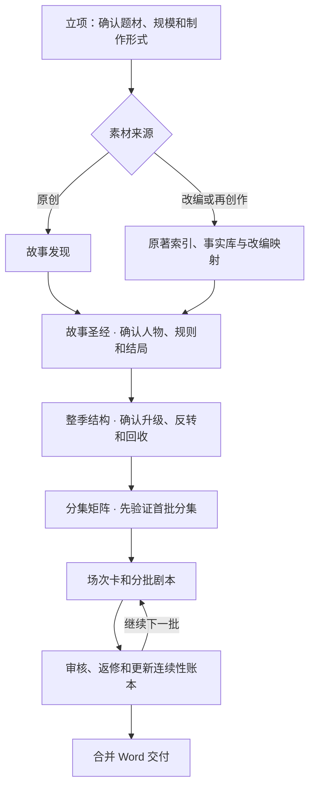

# 短剧编剧 · mm-write-short-drama

在 Codex 里写短剧。从一句创意、一份小说或已有剧本开始，你可以先定故事和人物，再排分集、写场次。每批审核通过后，合成一份可以发给演员和制片的 Word。

写到第八集才发现，主角用来对质的证据第三集已经被别人拿走了。这个技能把人物知道什么、道具在谁手里、伏笔在哪一集兑现都记在项目里。隔几天换个对话，你可以从上次确认的进度接着写。

[安装技能](#安装) · [内置编剧知识卡](#四本书对应的五项写作能力) · [跟做一个六集项目](#跟做一个六集项目) · [了解设计流程](#从创意到交付) · [下载 Word 版式样本](mm-write-short-drama/assets/screenplay-base-template.docx) · [联系开发者](#交流与反馈)

## 先看看你能用它做什么

| 手上有什么 | 可以先做哪一步 | 拿到什么 |
| --- | --- | --- |
| 一句话创意或一个人物 | 明确冲突、受众、集数、时长和制作形式 | 项目启动单、原创故事发现、故事圣经 |
| 有权使用的小说或故事 | 索引原文，标出哪些情节保留、压缩或重排 | 原著事实库、改编映射、故事圣经 |
| 大纲或写到一半的剧本 | 约定接写范围，核对角色已知信息和前集结尾 | 分集矩阵、场次卡、续写稿 |
| 待审的初稿 | 查角色动机、信息差、时间线、道具和伏笔，再改对白 | 问题单、复核记录、经审核的批次剧本 |
| 平时积累的编剧方法 | 整理为带来源、适用范围和状态的知识卡 | 可按阶段检索的个人编剧知识库 |

支持原创、小说改编和素材再创作。场次审核会考虑真人短剧、AI 真人剧、AI 漫剧或混合制作的实际条件。交付件是供演员、制片或后续分镜使用的定稿剧本。

## 安装

### 在 Codex 插件列表里安装

在终端运行这两条命令。第一条添加项目的 GitHub 插件来源，第二条安装「短剧编剧 · Screenwriter」。

```bash
codex plugin marketplace add CodeBlueFriend/mm-write-short-drama
codex plugin add mm-write-short-drama@short-drama
```

喜欢从列表安装的话，添加来源后，在 Codex CLI 输入 `/plugins`，切换到 `short-drama` 即可选中它。装好后开一个新对话，例如「用短剧编剧把这个想法整理成六集大纲」。[Codex 插件来源说明](https://developers.openai.com/plugins/build/plugins#add-a-marketplace-from-the-cli) · [插件隐私说明](docs/plugin-privacy.md)

### 通过技能安装器安装

在 Codex 粘贴下面这条指令，一次安装稳定版 [v1.2.2](https://github.com/CodeBlueFriend/mm-write-short-drama/releases/tag/v1.2.2)。Humanizer 规则、校验工具和三张编剧知识卡随技能一起安装。

```text
$skill-installer 从 https://github.com/CodeBlueFriend/mm-write-short-drama/tree/v1.2.2/mm-write-short-drama 安装技能
```

装好后，打开用来放原著和剧本的工作区，在对话中输入 `$mm-write-short-drama`，再说你想做什么。如果技能没有出现在列表里，重启 Codex。安装方式见 [Codex 技能文档](https://developers.openai.com/codex/skills#install-curated-skills-for-local-use)。

<details>
<summary>从 GitHub 手动安装</summary>

```bash
git clone --depth 1 --branch v1.2.2 \
  https://github.com/CodeBlueFriend/mm-write-short-drama.git
mkdir -p "$HOME/.agents/skills/mm-write-short-drama"
cp -R mm-write-short-drama/mm-write-short-drama/. "$HOME/.agents/skills/mm-write-short-drama/"
```

已经克隆仓库时，从仓库根目录把 `./mm-write-short-drama/.` 复制到当前 Codex 的技能目录即可。升级时先备份自己改过的技能文件。项目目录和个人知识库继续留在原来的工作区。

</details>

从立项到交稿都用 `$mm-write-short-drama`。审完剧本后，Codex 会用随附规则复核对白和连戏，用随附脚本记录通过校验的稿件，再按本批集数导出一份 Word。脚本需要 Python 3.10 或更新版本。如果工作区没有 `python-docx`，Codex 可在首次导出时给项目建独立环境并联网安装；版式目检使用当前环境可用的文档渲染器、Word 或 LibreOffice。[运行环境与导出步骤](mm-write-short-drama/references/word-delivery.md#准备-word-导出环境)

## 跟做一个六集项目

把这条试跑指令粘贴到 Codex。也可以换成你正想写的故事。

```text
$mm-write-short-drama 根据这个创意建立 6 集竖屏都市悬疑短剧：
一位便利店夜班店员替陌生人保管秘密，最后发现这些秘密都指向同一场旧案。
单集约 90 秒，低成本真人拍摄。采用严格确认模式。
本轮只做项目启动单、原创故事发现和故事圣经。
```

先看故事圣经里的选择。夜班店员为什么要查旧案？这件事会让他失去什么？确认这些设定后，就可以安排观众在哪一集知道什么。

1. **排整季。** 让 Codex 从结局反推信息揭示的顺序，确定追查什么时候升级。确认整季结构后，先看首批分集卡，每张卡交代该集开头的局面、关键变化和结尾留下的问题。
2. **写首批。** 让 Codex 拆第 1 至 3 集的场次卡。比如店员发现证据这一场，写清他想拿证据做什么、谁能阻止他、证据最后落到谁手里。确认这些变化后，再写成带动作和对白的 Markdown 剧本。
3. **接着写。** 换会话后，打开原项目工作区，说「读取项目状态、已锁定的设定和上一批结尾，接着写第 4 至 6 集」。审下一批时可以专查店员什么时候知道真相，及证据能不能出现在那一场。
4. **交稿。** 先处理审核问题，再更新账本和变更记录。按批次把批准的集数合并成一份 Word，发给演员或制片。

### 其他常用指令

| 想做什么 | 在 Codex 里怎么说 |
| --- | --- |
| 改编小说 | 「把工作区的 novel.md 改编成 24 集竖屏真人短剧。先建原著索引，标清原著事实、推断和改编决定。本轮只做到故事圣经。」 |
| 接手已有剧本 | 「先读已确认的设定、分集和前一批结尾，核对人物知道什么。给我下一批的场次卡看。」 |
| 专查穿帮 | 「审前十集的秘密揭示、伤势、时间顺序和道具去向。问题带集场位置、原文证据和最小修法，本轮只出审核单。」 |
| 改对白 | 「保持剧情事实、人物动机和场景结果，调整这场对白。让角色说出符合身份、目的和关系的话。」 |
| 收录自己的经验 | 「把这条编剧方法存为知识卡，保留原文和出处，限定适用题材。撞到重复或冲突时先给我看。」 |

已有素材时，把文件放入项目工作区并给出路径。小说原文用于改编项目。可复用的写作方法和来源记录放入个人知识库。

## 从创意到交付



| 阶段 | 这一步要解决的问题 | 代表产物 |
| --- | --- | --- |
| 立项 | 这是原创还是改编？面向谁？这次先做到哪一步？ | 项目启动单、素材与制作约束 |
| 故事圣经 | 主角为什么非做这件事？谁会阻止他？结局落在哪里？ | 核心关系、人物动机、世界规则与禁改项 |
| 整季 | 对抗如何升级？先给观众知道什么？哪些伏笔要回收？ | 整季结构、关系与信息变化 |
| 分集和场次 | 每集结束时什么变了？每场的动作和对白怎样推动变化？ | 分集矩阵、场次卡 |
| 剧本 | 台词能不能演？戏是否接得上前一集？ | 按集保存的剧本与连续性更新 |
| 审核和交稿 | 哪里出错、证据在哪里、修完哪些地方要重审？ | 问题单、审核摘要、合并 Word |

第一次用可选「严格确认」，在故事圣经、整季结构和首批分集各看一次方向。「辅助确认」把确认留给重大变化。「自动推进」适用于范围清楚的任务，遇到阻断问题、重大改编或锁定事实变更仍会停下。你可以直接指定当前想做的环节。

### 隔几天还能接着写

故事圣经记录全剧设定，分集矩阵交代每集的变化。时间线、人物状态、秘密、关系、道具、证据、钩子和伏笔分别有账可查。`.drama/` 记录产物依赖和逐集状态，下一次写作从这些文件恢复进度。

比如要把真相揭露从第 3 集挪到第 5 集，先看哪些场次会因为人物提前知情而出错，哪些卡点和回收需要调整。确认影响范围后，再更新相关场次和账本。

| 到哪里找 | 里面有什么 |
| --- | --- |
| `00-project-brief.md`、`04-story-bible.md` | 项目要求、角色设定和已经确认的故事前提 |
| `05-season-architecture.md`、`06-episode-matrix.csv` | 整季结构和每一集的变化 |
| `continuity/`、`context-packs/` | 连续性账本与续写这批时需要读的材料 |
| `.drama/`、`locked-decisions.md`、`change-log.md` | 进度、版本、依赖、锁定决定与变更记录 |
| `episodes/`、`reviews/`、`deliverables/` | 逐集源稿、审核问题和交付 Word |

审核从结构因果开始。改编项目先回看原文证据，再查人物动机和连续性，最后查节奏、对白、可制作性和格式。问题单记录集场、证据、P0 至 P3 等级和复检范围。后续写作只把用户锁定或经过审核确认的内容当作既定事实。[查看状态、审核与旧项目迁移设计](docs/current-design.md)

### 让自己的编剧方法用得上

把技巧粘贴到对话，或把文本放进 `knowledge-base/inbox/`。比如你常用「集尾承诺要在下一集兑现」，就可以把它记成一张卡，保留出处，注明在哪些题材的分集设计中使用。重复录入会留痕，疑似冲突等你裁决。写到分集时才检索这类启用卡，审核可追溯实际用过的规则。五项能力入口覆盖梗概、结构、秘密管理、集间兑现和对白行动。[知识库入门](knowledge-base/README.md) · [规则如何被检索](docs/current-design.md#五项写作能力与知识来源)

### 四本书对应的五项写作能力

装完技能，立项时就能查一句梗概，排整季时能查节拍，改对白时能查言语行动。三张内置卡都有短剧用法、原创例子和公开出处，空白项目也能用。

| 书目 | 写作能力 | 随技能安装的状态 |
| --- | --- | --- |
| 《救猫咪：电影编剧指南》 | 一句梗概。创意只有题材时，先厘清主角目标、阻力和失败代价。 | [已内置](mm-write-short-drama/assets/builtin-knowledge/cards/BUILTIN-LOGLINE.md) |
| 《救猫咪：电影编剧指南》 | 整季节拍。中段反复时，检查每个转折有没有改变局面和后续选择。 | [已内置](mm-write-short-drama/assets/builtin-knowledge/cards/BUILTIN-SEASON-BEATS.md) |
| 罗伯特·麦基《对白》 | 言语行动。对质场面卡住时，检查角色试图通过一句话让对方做什么。 | [已内置](mm-write-short-drama/assets/builtin-knowledge/cards/BUILTIN-VERBAL-ACTION.md) |
| 《编剧路线图》 | 人物秘密。可用连续性流程查谁在何时知道什么。 | 书籍卡待核验 |
| 《从零开始学短剧创作》 | 集尾兑现。可用现有流程对读集尾和下集开场。 | 书目已核对目录，具体写法为项目实践 |

```text
$mm-write-short-drama 用“一句梗概”内置卡检查我的创意。先找出主角想做什么、有什么阻力，再给一句可复述的版本。缺的设定请留作待确认项。
```

个人知识卡和原书资料继续在本地管理。上表标为待核验的书籍卡保持停用。

### 导出给演员和制片的 Word

以「第 01 至 03 集」为例，导出器把三集合进 `项目名_第01-03集.docx`。Word 保留场次、动作和对白等剧本正文，项目控制信息与连续性维护区留在工作区。版式采用宋体、黄色场次与人物提示、蓝色台词和自动页码。可选的前置信息来自当前项目已审核的材料。模板示例使用中性占位文字。[下载 Word 版式样本](mm-write-short-drama/assets/screenplay-base-template.docx) · [交付和导出规则](mm-write-short-drama/references/word-delivery.md)

## 深入使用

| 想查什么 | 从这里看 |
| --- | --- |
| 刚装好，想照着提示词试跑 | [可复制的测试提示](docs/test-prompts.md) |
| 想直接管理状态、索引、校验与导出 | [命令行使用手册](docs/usage.md) |
| 想维护个人写作知识库 | [知识库目录与维护](knowledge-base/README.md) |
| 正在升级或接手旧项目 | [v1.2.1 安装与升级说明](docs/versions/v1.2.1.md) · [v1.2 功能说明](docs/versions/v1.2.md) |
| 想读工作流、脚本、状态和依赖设计 | [工作流设计](docs/current-design.md) |
| 想看以前的版本 | [完整变更记录](CHANGELOG.md) · [v1.1](docs/versions/v1.1.md) · [v1.0](docs/versions/v1.0.md) |

### 常见问题

- **想先看看流程，必须准备整部长篇吗？** 一句话创意就能立项，也可以只拿一场戏做对白或连续性诊断。
- **原著和知识库放哪儿？** 自己的剧本和参考材料放工作区。知识库放在长期使用的目录，升级时更新技能目录即可。
- **以前的工程没有状态文件怎么办？** 先检查现有文件并拟定迁移方案，确认后再补状态和账本。只改一小段时，可直接在现有材料范围内工作。
- **Codex 里找不到技能怎么办？** 确认所装目录下直接有 `SKILL.md`，再重启 Codex。命令和依赖问题可以参照[使用手册](docs/usage.md)。

## 交流与反馈

开发者微信 **东南枝**。用微信扫一扫添加，备注「短剧编剧」。如果你在某一步卡住，或有一种常用写法想加入，欢迎带着具体例子来聊。

<a href="docs/images/wechat-dongnanzhi.jpg"></a>

也可以通过 [GitHub Issues](https://github.com/CodeBlueFriend/mm-write-short-drama/issues) 提报 Bug 或建议。说清你在做哪一步、预期什么、实际发生了什么。需要举例时，用可以公开的最小片段。

项目代码和文档采用 [MIT 许可](LICENSE)。改编素材和外部依赖各自适用其授权条款。
