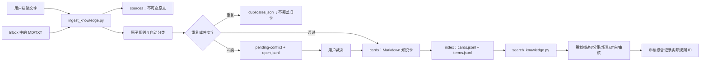
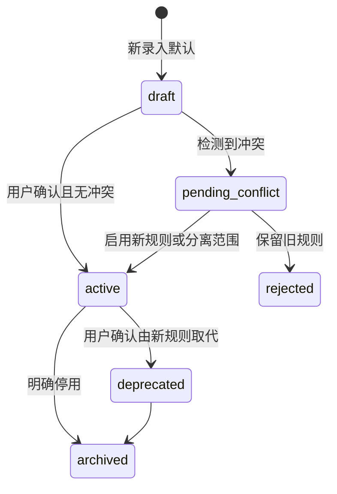
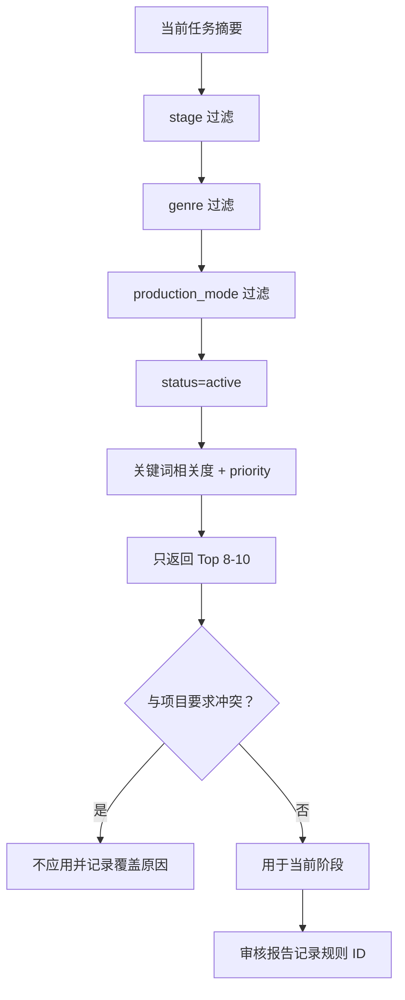

# v1.1 个人编剧知识库系统设计

## 1. 目标与边界

v1.1 把两个变化速度不同的对象拆开：

- `mm-write-short-drama/`：稳定的创作状态机、审核门、项目连续性和制作约束；
- `knowledge-base/`：用户长期录入、不断修订和带来源追溯的个人编剧知识。

Skill 升级不覆盖个人知识；增加技巧不改写 Skill。首版使用 Markdown 与 JSONL，支持 Git 版本管理、人工审阅和确定性检索，不引入向量数据库。

## 2. 总体架构



## 3. 目录职责

```text
knowledge-base/
├── inbox/                 # 待处理原文件；处理后仍保留
├── sources/               # 以 SHA-256 标识的不可变原文副本
├── cards/                 # 一条原子规则一张 Markdown 卡
├── index/
│   ├── cards.jsonl        # 可重建检索索引
│   ├── terms.jsonl        # 确定性词项倒排索引
│   └── ingest-log.jsonl   # 每次录入的结果
├── conflicts/
│   ├── open.jsonl         # 待用户裁决
│   ├── duplicates.jsonl   # 重复检测记录
│   └── resolutions.jsonl  # 追加式裁决记录
└── archive/               # 状态/版本变化前的知识卡快照
```

`sources/` 是证据层；`cards/` 是知识层；`index/` 是可丢弃并重建的检索层。索引不能成为知识事实源。

## 4. 知识卡格式

知识卡是可读 Markdown，机器字段放在标记区间内的 JSON 块。这样无需 YAML 依赖，也避免用脆弱正则理解任意 Markdown。

````markdown
# 首次有效反击

<!-- knowledge-card:start -->
```json
{
  "id": "EPISODE-8C6A...",
  "title": "首次有效反击",
  "rule": "主角第一次有效反击必须改变资源、关系或信息状态。",
  "rationale": "可观察状态变化才能让反击进入后续因果。",
  "category": "分集与卡点",
  "stage": ["episode"],
  "genre": ["女频复仇"],
  "production_mode": ["all"],
  "priority": "preferred",
  "exceptions": ["经确认的前期压抑型结构"],
  "positive_example": "女主公开账本后夺回表决权。",
  "negative_example": "女主只把反派骂走，局势没有变化。",
  "source": {
    "source_id": "SRC-20260810-...",
    "stored_path": "knowledge-base/sources/...",
    "original_name": "lesson-12.md",
    "sha256": "...",
    "captured_at": "2026-08-10T...+08:00"
  },
  "status": "active",
  "version": 1
}
```
<!-- knowledge-card:end -->
````

ID 由分类前缀和规范化规则正文哈希构成。标题变化不改变 ID；规则语义改变应作为新候选录入，不能覆盖旧规则。

## 5. 状态机



默认检索只返回 `active`。`pending-conflict` 即使用户在命令中要求 active，也会被强制冻结。每次显式状态变化前，把旧卡复制到 `archive/`，版本加一并写入裁决日志。

## 6. 录入流程

### 6.1 对话直接粘贴

1. 用 `--text` 把用户原文完整交给脚本；若原文混合规则、范围和解释，用 `--rule` 单独提供提炼后的原子规则；
2. 在 `sources/` 保存原文与 SHA-256；
3. 解析半结构化字段、项目符号或普通段落；
4. 一条候选只保留一个可执行规则；
5. 用关键词启发式给出分类、阶段和制作范围；
6. 与已有卡片做高相似重复检测；
7. 对范围重叠、方向相反的规则做冲突提示；
8. 创建卡片并重建索引；
9. Codex 语义复核分类、边界、理由、例外和例子。

自动分类只是候选，不能代替编剧判断。

### 6.2 批量 Inbox

脚本递归读取 `inbox/` 中 `.md/.txt`，跳过 README、模板和隐藏文件。原文件保持原路径和字节不变；每份资料另存不可变来源副本。重复执行安全：相同规则不会覆盖卡片，只新增重复日志。

## 7. 重复与冲突

重复检测比较规范化全文与相似度。命中后：

- 不创建新卡；
- 不改旧卡；
- 保留新来源；
- 在 `duplicates.jsonl` 写候选、旧 ID 和处理结果。

冲突检测是保守提示，不宣称能理解所有编剧理论。首版捕捉“适用范围重叠 + 核心文本相似 + 必须/不得等方向相反”的情况。命中后新卡状态为 `pending-conflict`，等待用户决定：

1. `keep-existing`：旧规则继续生效，新卡标记 rejected；
2. `activate-new`：旧规则归档并 deprecated，新卡 active；
3. `keep-both`：用户写明已分离的适用范围，两者保留。

## 8. 检索与实际调用

检索使用字段过滤与确定性词项相关度，不扫描整个卡片目录进入模型上下文：



阶段映射：

| 创作任务 | `stage` |
|---|---|
| 故事发现、人物与故事圣经 | `planning` |
| 整季结构、升级与揭示 | `structure` |
| 分集、开场、钩子、卡点 | `episode` |
| 场次、动作、权力变化 | `scene` |
| 对白、潜台词、声纹 | `dialogue` |
| 小说拆解与改编映射 | `adaptation` |
| 连续性、制作、去 AI 味终审 | `review` |

优先级永远是：当前项目明确要求与锁定事实 > 安全/版权硬约束 > 个人知识库。知识库中的 `hard` 只表示用户自己的高优先级知识，不能覆盖项目明确选择。

## 9. 小说上传与改编示例

### 文件准备

在 Codex 中上传有权使用的小说 `.md` 或 `.txt`，或把文件放到工作区，例如 `source/novel.md`。知识库不是小说正文存储区；小说属于短剧项目素材。

```bash
python3 mm-write-short-drama/scripts/init_project.py \
  ./projects/小说改编 --mode adaptation --through story-bible

python3 mm-write-short-drama/scripts/index_source.py \
  ./source/novel.md \
  -o ./projects/小说改编/01-source-index.md

python3 mm-write-short-drama/scripts/search_knowledge.py \
  "把长篇小说压缩为24集，先建立原著事实和改编映射" \
  --kb ./knowledge-base \
  --stage adaptation \
  --genre 都市情感 \
  --production-mode live-action \
  --limit 8 \
  --format context
```

在 Codex 中使用：

```text
$mm-write-short-drama 把我上传的 novel.md 改编成24集竖屏真人短剧，单集90秒。
项目个人知识库使用 ./knowledge-base。
先索引全文，区分原著事实、合理推断、改编决定和待确认项；
只检索 adaptation 阶段、都市情感、live-action 相关的 active 知识卡。
本轮只交付原著事实库、改编映射和故事圣经，不写分集和剧本。
审核摘要列出实际使用的知识规则 ID。
```

## 10. 根据思路原创短剧示例

```bash
python3 mm-write-short-drama/scripts/init_project.py \
  ./projects/夜班秘密 --mode original --through story-bible

python3 mm-write-short-drama/scripts/search_knowledge.py \
  "便利店夜班店员替陌生人保管秘密，设计故事引擎与人物关系" \
  --kb ./knowledge-base \
  --stage planning \
  --genre 都市悬疑 \
  --production-mode live-action \
  --limit 8 \
  --format context
```

在 Codex 中使用：

```text
$mm-write-short-drama 根据这个思路原创6集竖屏都市悬疑短剧：
一位便利店夜班店员替陌生人保管秘密，最后发现秘密都指向同一场旧案。
低成本真人拍摄，单集90秒，结局温暖但不能靠巧合。
使用 ./knowledge-base，只检索 planning 阶段相关的 active 规则。
严格确认模式，先完成项目启动单、原创故事发现和故事圣经；
不要直接写分集。说明实际使用了哪些规则 ID。
```

进入整季结构、分集、场景和对白时分别重新检索对应阶段，不沿用一大包旧规则。

## 11. 校验策略

`validate_knowledge.py` 检查：六个目录、所有必填字段、枚举值、ID/文件名一致、版本号、来源路径与 SHA-256、重复规则、JSONL 语法、索引是否过期、冲突引用和未解决冲突状态。

GitHub Actions 运行完整单元测试。测试覆盖对话录入、批量录入、原文保留、重复不覆盖、冲突冻结与裁决、阶段检索、实际调用上下文和 v1 原创/改编脚本回归。
